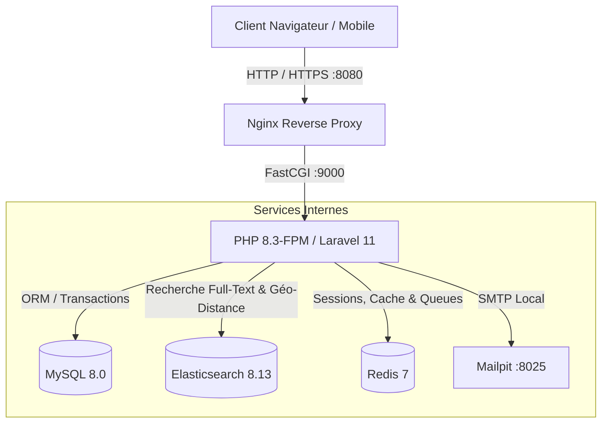

# 🎓 StudentHousing - Plateforme de Logements Étudiants

[](https://student-housing-zvgu.onrender.com/)

[](https://github.com/)
[](https://www.php.net/)
[](https://laravel.com/)
[](https://www.elastic.co/)
[](https://www.docker.com/)
[](https://render.com/)
[](https://opensource.org/licenses/MIT)

> **Plateforme web moderne d'hébergement pour étudiants**, réarchitecturée selon les standards de l'ingénierie logicielle senior : conteneurisation Docker complète, moteur de recherche full-text & géo-spatial avec **Elasticsearch 8**, sécurisation OWASP Top 10 et tests automatisés.

---

## 🏛️ Architecture & Écosystème



---

## ✨ Fonctionnalités Clés

* 🔍 **Moteur de Recherche Elasticsearch 8 :**
  * Analyseur linguistique français dédié (`elision`, `stemmer`, `stopwords`).
  * Recherche tolérante aux fautes de frappe (*Fuzziness AUTO*).
  * Filtre géo-spatial par proximité de campus (`geo_point` / `geo_distance`).
  * Agrégations & statistiques de prix en temps réel.
* 🛡️ **Sécurité Avancée (OWASP Top 10) :**
  * Zéro injection SQL (ORM Eloquent typé & requêtes préparées).
  * Hachage de mots de passe moderne (**Argon2id / Bcrypt**).
  * Protection stricte Anti-CSRF, Anti-XSS et en-têtes HTTP sécurisés.
  * Verrouillage pessimiste en base (`lockForUpdate`) pour éliminer tout risque de double-réservation simultanée.
  * Contrôle d'accès strict (Anti-IDOR / BOLA) sur chaque ressource et réservation.
* ⚡ **DevOps & Industrialisation :**
  * Environnement 100 % reproductible avec Docker Compose.
  * Pipeline CI GitHub Actions (Linting Pint, PHPStan niveau 8, tests PHPUnit, build Docker).

---

## 🚀 Démarrage Rapide (En 3 étapes)

### Prérequis
* [Docker Desktop](https://www.docker.com/) installé et actif.
* [Git](https://git-scm.com/)

### 1. Cloner et démarrer l'infrastructure
```bash
# Cloner le dépôt
git clone https://github.com/takwahafyen/projet-logement-etudiants.git
cd projet-logement-etudiants

# Copier le fichier d'environnement
cp .env.example .env

# Démarrer tous les services conteneurisés
docker compose up -d --build
```

### 2. Initialiser l'application & les données
```bash
# Installer les dépendances Composer
docker compose exec app composer install

# Générer la clé applicative
docker compose exec app php artisan key:generate

# Exécuter les migrations et le jeu d'essai réaliste
docker compose exec app php artisan migrate --seed

# Initialiser l'index et le mapping Elasticsearch
docker compose exec app php artisan elastic:init-housing
```

### 3. Accéder aux services
* 🌐 **Application Web :** [http://localhost:8080](http://localhost:8080)
* 🔍 **Cluster Elasticsearch :** [http://localhost:9200](http://localhost:9200)
* 📬 **Boîte Mail Locale (Mailpit) :** [http://localhost:8025](http://localhost:8025)

---

## 👤 Comptes de Démonstration

| Rôle | Email | Mot de passe |
| :--- | :--- | :--- |
| **Administrateur** | `admin@studenthousing.com` | `AdminPass123!` |
| **Bailleur / Propriétaire** | `owner@studenthousing.com` | `OwnerPass123!` |
| **Étudiant** | `student@studenthousing.com` | `StudentPass123!` |

---

## 🧪 Qualité & Tests Automatisés

```bash
# Exécuter les tests unitaires et fonctionnels
docker compose exec app composer test

# Exécuter l'analyse statique PHPStan (Niveau 8)
docker compose exec app composer analyse

# Formater le code selon les standards PSR-12 / Pint
docker compose exec app composer format
```

---

## 📂 Structure du Projet

```text
├── .github/workflows/ci.yml       # Pipeline CI/CD GitHub Actions
├── app/
│   ├── Console/Commands/          # Commandes Artisan (Indexation Elasticsearch)
│   ├── Http/Controllers/          # Contrôleurs Web & API
│   ├── Models/                    # Modèles Eloquent & Searchable Scout
│   └── Services/                  # Services métier (Booking, Elasticsearch)
├── database/
│   ├── migrations/                # Schémas de données relationnels
│   └── seeders/                   # Données de démonstration réalistes
├── docker/
│   ├── nginx/conf.d/              # Configuration Nginx optimisée
│   └── php/Dockerfile             # Image PHP 8.3 FPM + extensions Redis/MySQL
├── resources/views/               # Vues Blade & UI TailwindCSS
├── routes/                        # Routes web et API sécurisées
├── tests/                         # Tests unitaires et d'intégration
├── composer.json                  # Dépendances PHP 8.3 / Laravel 11 / Elastic
├── docker-compose.yml             # Orchestration 6 conteneurs
└── phpstan.neon                   # Configuration analyse statique niveau 8
```

---

## 🌐 Déploiement en Ligne (Production)

L'application est déployée publiquement sur **Render** via son Blueprint d'infrastructure as Code ([`render.yaml`](file:///c:/Users/DEll/Desktop/projet-logement-etudiants-master/projet-logement-etudiants-master/render.yaml)) :

* **URL Publique :** [https://student-housing-zvgu.onrender.com/](https://student-housing-zvgu.onrender.com/)
* **Stack Production :** Conteneur Docker unifié (Nginx + PHP 8.3 FPM gérés par Supervisor) + PostgreSQL managé.

### 🔑 Comptes de démonstration pré-configurés :

| Rôle | Email | Mot de passe | Permissions |
| :--- | :--- | :--- | :--- |
| **Étudiant (Locataire)** | `student@studenthousing.com` | `StudentPass123!` | Recherche, réservation, gestion de ses réservations |
| **Bailleur (Propriétaire)** | `owner@studenthousing.com` | `OwnerPass123!` | Publication et gestion d'annonces de logements |
| **Administrateur** | `admin@studenthousing.com` | `AdminPass123!` | Modération, supervision et gestion globale |

---

## 📄 Licence
Ce projet est sous licence MIT.
